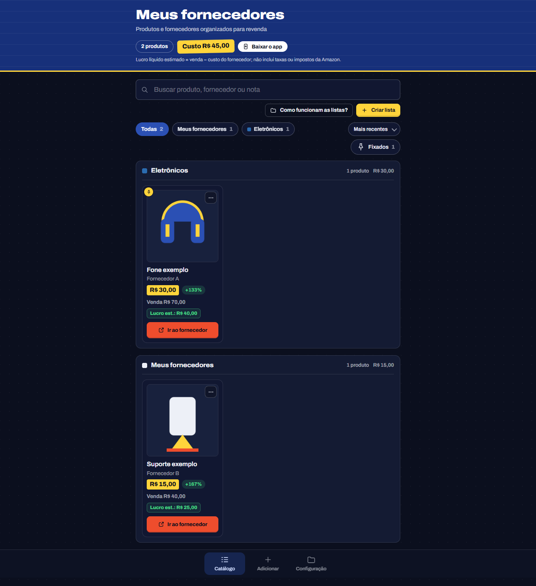

# Salvar Fornecedor

**Um catálogo pessoal de produtos e fornecedores para quem vende pela Amazon no modelo FBM.**

| Acessar o app | Código-fonte |
| --- | --- |
| [fornecedorsave.netlify.app](https://fornecedorsave.netlify.app/) | [github.com/tiozinhow/salvar-fornecedor](https://github.com/tiozinhow/salvar-fornecedor) |



*Captura ilustrativa: os produtos e fornecedores mostrados são exemplos, não dados reais.*

Você pode abrir o site no navegador, instalar como um app no celular ou computador, ou hospedar sua própria cópia. Não precisa instalar pela Play Store/App Store nem criar uma conta.

## Conteúdo

- [Sobre o projeto](#sobre-o-projeto)
- [O que o app faz](#o-que-o-app-faz)
- [Como usar](#como-usar)
- [Usar como app (PWA)](#usar-como-app-pwa)
- [Dados, privacidade e backups](#dados-privacidade-e-backups)
- [Busca automática de produtos](#busca-automatica-de-produtos)
- [Hospedar na Netlify](#hospedar-na-netlify)
- [Executar localmente](#executar-localmente)
- [Arquivos principais](#arquivos-principais)
- [Contribuir e licença](#contribuir-e-licenca)

## Sobre o projeto

Salvar Fornecedor é um site estático e instalável para guardar links de produtos, anotar fornecedores e organizar itens que você pesquisa para revender. Ele foi pensado para apoiar a rotina de vendedores FBM, que cuidam do próprio envio.

O site publicado é público, mas **o catálogo de cada pessoa não fica público**. A hospedagem entrega os arquivos do app; os produtos e as listas ficam no armazenamento do navegador usado por cada pessoa. Não há servidor de aplicação, login ou sincronização entre usuários.

O projeto não se conecta à conta Seller Central e não controla anúncios, pedidos, estoque vendido, etiquetas ou rastreamento. Ele funciona como catálogo de pesquisa e organização de fornecedores.

## O que o app faz

- Guarda ficha de produto com link, nome, fornecedor, custo, preço de venda, imagem e notas.
- Tenta preencher nome, preço e imagem a partir do link. Dependendo do resultado, colar o link pode salvar o produto automaticamente ou abrir os dados para revisão.
- Agrupa produtos em listas por fornecedor, categoria, campanha ou outro critério. Cada lista pode ter uma cor pronta ou personalizada.
- Deixa pesquisar, filtrar por lista, ordenar e fixar produtos importantes no topo.
- Mostra o lucro líquido estimado pela conta **preço de venda − custo do fornecedor**. Esse valor **não desconta** comissão, taxas ou impostos da Amazon, frete FBM, embalagem, anúncios ou outros custos.
- Salva o catálogo automaticamente no navegador e permite baixar/restaurar um backup JSON. Restaurar acrescenta dados que ainda não existem no catálogo, sem substituir os produtos já salvos.
- Pode abrir offline depois que os arquivos do app forem armazenados em cache. Buscar dados externos e carregar imagens que não estejam disponíveis localmente exige internet.

## Como usar

1. Abra [o site](https://fornecedorsave.netlify.app/) e escolha **Adicionar**.
2. Cole um link de produto. O app tenta buscar os dados disponíveis; confira nome, foto e preço, pois a busca automática pode não encontrar tudo.
3. Preencha o **custo do fornecedor** e, se souber, o **preço de venda**. Você também pode guardar o nome do fornecedor, uma nota e escolher uma lista.
4. No **Catálogo**, pesquise os produtos ou filtre pelas listas. Os itens sem lista aparecem em **Meus fornecedores**.
5. Em **Configuração**, crie e edite listas, escolha cores, faça backups, encontre as opções do app e acesse outros projetos. O botão **Como funcionam as listas?** explica a organização.

O lucro exibido é apenas uma estimativa inicial: por exemplo, R$ 100 de venda menos R$ 40 de custo do fornecedor resulta em R$ 60 estimados, antes dos custos que o app não calcula.

## Usar como app (PWA)

O site também é um **PWA** (Progressive Web App): continua sendo o mesmo site, mas pode ser instalado e aberto numa janela própria, como um app.

- No celular, abra o site e use **Configuração → Usar como app**. No Android, o navegador oferece a instalação; no iPhone/iPad, o app mostra o passo a passo para usar **Adicionar à Tela de Início** no Safari.
- No computador, use a opção de instalar exibida pelo navegador compatível.
- Não há publicação em loja de aplicativos. As atualizações vêm da versão hospedada no site.
- Depois de abrir o site online pelo menos uma vez, o catálogo salvo e os arquivos principais podem continuar acessíveis offline. A busca de produtos, links externos e imagens não armazenadas ainda dependem de internet.

## Dados, privacidade e backups

- Produtos, listas e preferências são guardados localmente no navegador, neste aparelho e perfil. O app tenta manter uma cópia local de recuperação, mas isso **não é um backup na nuvem**.
- Usar o mesmo endereço em outro aparelho não transfere o catálogo. Uma cópia hospedada em outro domínio também tem um armazenamento separado. Exporte um backup em **Configuração → Backup do catálogo** e restaure-o no outro navegador ou domínio.
- Limpar os dados do site/navegador pode apagar o catálogo local. Baixe backups regularmente e guarde o arquivo JSON fora do navegador.
- A restauração é aditiva: importa listas e produtos que ainda não estão no catálogo, sem substituir os produtos existentes.
- O Netlify e o GitHub servem o site e o código; o app não envia o catálogo inteiro para eles.

### Segurança e privacidade

O app foi feito para manter o catálogo no navegador, sem uma conta ou banco de dados central. Isso significa que outros visitantes do site não conseguem ver o catálogo salvo no seu aparelho. O endereço oficial da Netlify usa HTTPS; para uma hospedagem própria, use também um host com HTTPS. Isso protege a conexão, mas não torna o aparelho ou os backups invulneráveis.

O app não criptografa os dados locais nem os arquivos JSON de backup. Quem tiver acesso ao seu aparelho e ao perfil do navegador poderá acessar o catálogo; proteja o aparelho e guarde os backups em local privado. Não use o catálogo para senhas, dados de pagamento ou outras informações secretas. A busca automática também envia o link do produto a serviços externos, como explicado abaixo. Não há auditoria de segurança independente nem promessa de segurança absoluta.

## Busca automática de produtos

Para tentar ler metadados da página do produto, o navegador consulta serviços públicos de proxy/metadados, como AllOrigins, Jina, CORSProxy, CodeTabs, Dub e Microlink. A URL do produto é enviada aos serviços consultados durante essa tentativa. Eles podem ficar indisponíveis, limitar consultas ou mudar; por isso, confira os dados e complete a ficha manualmente quando necessário.

## Hospedar na Netlify

Você pode usar o site público acima ou publicar uma cópia sua. Uma cópia própria terá outro endereço e um catálogo local separado. O repositório já inclui `netlify.toml` e não precisa de build.

1. Entre na Netlify e escolha **Add new site → Import an existing project**.
2. Conecte o GitHub e selecione `tiozinhow/salvar-fornecedor` (ou o seu fork/cópia) e a branch `main`.
3. Use a raiz do repositório como diretório base, deixe **Build command** vazio e defina **Publish directory** como `.`.
4. Clique em **Deploy**. A Netlify publica diretamente `index.html`, os arquivos JavaScript/CSS, o manifesto e os ícones. O site recebe HTTPS, necessário para instalação e funcionamento do service worker.

Para manter o endereço `fornecedorsave.netlify.app`, conecte o repositório ao site Netlify existente. Se estiver criando outro site, escolha um nome disponível; a Netlify fornece um endereço próprio. Com a integração GitHub ativa, novos commits na branch conectada geram novas publicações automaticamente.

### Publicar sem rodar servidor ou build

Também dá para baixar os arquivos e enviar a pasta pronta diretamente à Netlify:

1. No GitHub, abra o repositório, escolha **Code → Download ZIP** e extraia o arquivo no computador.
2. Confira que a pasta que será enviada contém `index.html` na raiz, junto de `app.js`, `styles.css`, `sw.js`, `manifest.webmanifest` e `icons/`.
3. Abra [Netlify Drop](https://app.netlify.com/drop) e arraste essa pasta para a área de publicação. Não precisa iniciar `python -m http.server`, instalar dependências ou executar um build para publicar.
4. A Netlify cria um endereço para o site. Para atualizar uma publicação manual, envie novamente a pasta atualizada pela área de **Deploys** do site.

Esse método é simples para publicar uma cópia. Para receber atualizações automaticamente quando o código mudar, use a integração GitHub descrita acima.

## Executar localmente

Não há dependências para instalar. Com Python, rode na pasta do projeto:

```bash
python -m http.server 8000
```

Depois abra [http://localhost:8000](http://localhost:8000). Usar `localhost` permite testar o service worker; abrir `index.html` diretamente como arquivo (`file://`) não é recomendado.

## Arquivos principais

- `index.html` — telas, navegação e modelo dos produtos.
- `styles.css` — visual responsivo para celular e computador.
- `app.js` — listas, busca, estimativa, armazenamento local e backups.
- `sw.js` — cache dos arquivos do app para uso offline.
- `manifest.webmanifest` e `icons/` — nome e ícones usados na instalação PWA.
- `netlify.toml` — publicação da raiz e atualização do service worker.
- `docs/catalogo-exemplo.png` — captura ilustrativa do catálogo com dados fictícios.

## Contribuir e licença

Issues e pull requests são bem-vindos. Não envie dados pessoais, catálogos reais ou arquivos de backup em commits.

### Créditos

- **tiozinhow** — projeto e manutenção do repositório.
- [**OpenCode, da AnomalyCo**](https://github.com/anomalyco/opencode) — ferramenta de assistência usada na programação, nos testes e na documentação.

O código é distribuído sob a licença MIT. Consulte [`LICENSE`](LICENSE).
